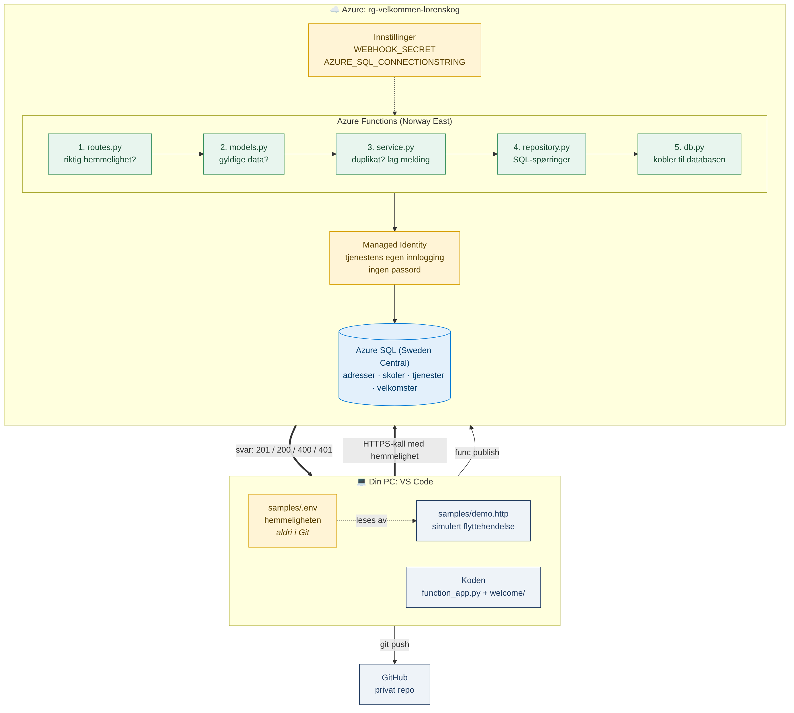

# Velkommen til Lørenskog

En tjeneste som automatisk lager en personlig velkomst til nye innbyggere i Lørenskog kommune.

> Et demo-prosjekt. Adressene og koblingen mellom adresse og skole er eksempeldata.

## Problemet

Når man flytter til en ny kommune, er det mye å finne ut av: skole, barnehage, avfall og fastlege. Lørenskog har en god side for nye innbyggere, men den er lik for alle, og innbyggeren må selv finne den og lete fram det som gjelder dem.

**Målgruppe:** nye innbyggere, og kommunen som ønsker at de kommer raskt i gang.

**Antakelse som bør testes:** en automatisk og personlig velkomst gjør det lettere å komme i gang, og gir færre spørsmål til kommunen. Det har jeg ikke målt, og det burde vært testet med ekte brukere.

## Hva tjenesten gjør

- Tar imot en flyttehendelse fra et annet system (webhook)
- Finner skolen som hører til adressen
- Lager en kort velkomst med lenker til kommunens egne sider og andre offisielle tjenester
- Tar bare med skole og barnehage når det er relevant

**Eksempel på en velkomst:**

```
Hei Kari, og velkommen til Lørenskog!

Skole og barnehage:
- Skolen for adressen er Fjellhamar skole: https://www.lorenskog.kommune.no/fjellhamar-skole
- Skoletilhørighet: Kart over inntaksområder, skolestart og bytte av skole. https://www.lorenskog.kommune.no/tjenester/barnehage-og-skole/skole/skoletilhorighet-bytte-skole/
- Barnehage: Les om barnehagetilbudet i kommunen og hvordan du søker plass. https://www.lorenskog.kommune.no/tjenester/barnehage-og-skole/barnehage/

Praktisk informasjon:
- Avfall og renovasjon: ROAF håndterer husholdningsavfallet. Se hva du kan kaste og hvor. https://www.roaf.no/
- Fastlege: Velg fastlege på Helsenorge. https://www.helsenorge.no/fastlegen/
- Aktiviteter: Finn aktiviteter og tilbud fra kommunen, lag og foreninger. https://lorenskog.friskus.com/

Vi er glade for å ha deg her!
```

## Slik henger det sammen



1. Et annet system sender en flyttehendelse til API-et. I demoen simulerer jeg den.
2. Tjenesten sjekker at avsenderen kjenner den delte hemmeligheten, og at dataene er gyldige.
3. Hvis hendelsen er behandlet før, returneres samme velkomst. Det blir aldri to velkomster for samme hendelse.
4. Adressen og tjenestene slås opp i databasen, og velkomsten lages og lagres.

## Tekniske valg

| Valg | Hvorfor | Alternativ jeg valgte bort |
|---|---|---|
| Python | Lett å lese og skrive, og godt egnet til integrasjoner | |
| Azure Functions | Kjører bare når en hendelse kommer, og koster bare da | App Service: alltid på, men dyrere for noe som brukes sjelden |
| Webhook | Tjenesten reagerer med en gang noe skjer | Polling: spørre jevnlig etter nye flyttinger, som gir forsinkelse og unødvendige kall |
| Azure SQL | Dataene henger sammen (adresse → skole), og alle instanser deler én database | SQLite i skyen: fungerte ikke, se under |
| SQLite lokalt | Raske tester uten skytilgang | |
| Managed Identity | Tjenesten logger inn i databasen uten passord | Brukernavn og passord i innstillingene |
| Koden delt i lag | Hver fil har én jobb, så den er lett å teste og endre | All kode i én fil |

**Hva jeg lærte:** lokalt fungerte duplikatsjekken, men i Azure laget samme hendelse to velkomster. Tjenesten kjørte på flere instanser, og hver hadde sin egen SQLite-fil. Løsningen var å flytte til Azure SQL, slik at alle deler én database.

## Avgrensninger

Dette er en første versjon som virker fra start til slutt. Bevisst utenfor:

- Velkomsten lages og lagres, men **sendes ikke** ennå (neste steg er en Logic App som sender e-post)
- Flyttehendelsen er simulert. Hvilken kilde som kan brukes i virkeligheten, må avklares med kommunen
- Adresser og skolekretser er eksempeldata, ikke kommunens inntaksområder
- Databasen er på gratisnivå og pauses etter 15 minutter uten bruk. Første kall etterpå kan feile med 500 mens den våkner
- Databasen ligger i Sweden Central, fordi abonnementet ikke fikk opprette SQL-server i Norway East

## Kvalitet

**Tester** (`python -m pytest -v`) som sjekker de viktigste reglene:
- samme hendelse gir bare én velkomst
- skole og barnehage tas bare med for familier med barn
- ukjent adresse gir en tydelig feil

**Feilhåndtering:** ugyldige data gir 400 med en forklaring, feil hemmelighet gir 401, ukjent adresse gir 422, og en velkomst som ikke finnes gir 404.

**Klart språk og universell utforming:** tjenesten har ikke eget grensesnitt, så det er ikke gjort noen WCAG-gjennomgang. Meldingen er kort, i klart språk, delt i tydelige overskrifter, og lenker til kommunens egne sider. Hvis den sendes som e-post eller vises på en nettside, må den følge kravene til universell utforming som gjelder for offentlig sektor. Flere språk er et naturlig neste steg.

## Personvern og sikkerhet

- Lagrer bare det som trengs: navn, e-post, adresse og om man ønsker informasjon om skole og barnehage. Ingenting om barna
- Dataene ligger i Azure i EU/EØS (Norway East og Sweden Central)
- Behandlingsgrunnlag er ikke vurdert, og må avklares med kommunens personvernombud før bruk
- Tjenesten logger inn i Azure SQL med Managed Identity, så det finnes ikke noe databasepassord
- Tjenesten har bare lov til å lese og skrive data, ikke å endre tabeller (least privilege)
- Databaseserveren tillater bare innlogging med Microsoft Entra ID
- Alle SQL-spørringer bruker parametere, som hindrer SQL-injeksjon
- Webhook-hemmeligheten ligger i innstillinger, ikke i koden eller i Git
- Logger inneholder bare hendelses-id, ikke navn eller e-post

## Demo

`samples/demo.http` inneholder alle kallene. Med VS Code-utvidelsen REST Client kjøres de ett og ett med «Send Request». Hemmeligheten leses fra `samples/.env`, som aldri ligger i Git.

| Kall | Viser |
|---|---|
| Helsesjekk | Tjenesten kjører (200) |
| Uten hemmelighet | Ukjente avsendere stoppes (401) |
| Ny flyttehendelse | Velkomst laget (201) |
| Samme hendelse igjen | Ingen duplikat (200, samme id) |
| Vis velkomsten | Meldingen slik innbyggeren ser den |
| Mangler e-post | Ugyldige data stoppes (400) |

## API

| Metode | Adresse | Beskrivelse |
|---|---|---|
| GET | `/api/health` | Viser at tjenesten kjører |
| POST | `/api/events/move-in` | Tar imot en flyttehendelse. Krever headeren `X-Webhook-Secret` |
| GET | `/api/welcome/{id}` | Henter en velkomst som JSON |
| GET | `/api/welcome/{id}?format=text` | Viser velkomsten som vanlig tekst |

## Kjøre lokalt

Krav: Python 3.11 og Azure Functions Core Tools.

```
python -m venv .venv
.venv\Scripts\Activate.ps1
pip install -r requirements-dev.txt
copy local.settings.example.json local.settings.json
python scripts/init_db.py
func start
```

Sett en verdi for `WEBHOOK_SECRET` i `local.settings.json` før du starter. Lokalt brukes SQLite.

## Struktur

```
function_app.py     Inngangen til tjenesten
welcome/            Koden, delt i lag
  routes.py           Tar imot HTTP-kall og sjekker hemmeligheten
  models.py           Validerer flyttehendelsen
  service.py          Duplikatsjekk og velkomstmelding
  repository.py       Alle SQL-spørringer
  db.py               Kobler til Azure SQL eller lokal SQLite
database/
  sqlite/             Tabeller og testdata for lokal SQLite
  azuresql/           Tabeller og testdata for Azure SQL
scripts/init_db.py  Lager den lokale databasen
tests/              Tester
samples/            Eksempel på en flyttehendelse og demo-fil
docs/               Arkitekturdiagram
```

## Neste steg

1. Logic App som sender velkomsten på e-post, og en påminnelse etter 14 dager
2. Automatisk retry når databasen våkner fra pause
3. API Management foran API-et, og hemmeligheten i Azure Key Vault
4. Strammere nettverkstilgang til databasen (private endpoint)
5. Slette gamle data automatisk
6. Flere språk i meldingen
7. Bruke kommunens data om inntaksområder i stedet for eksempeldata